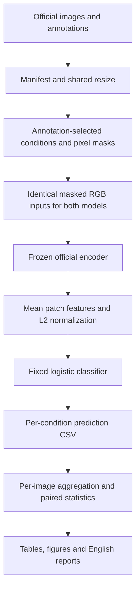

# Code guide

This guide explains the actual implemented evaluation. Read it before the full script inventory. The project adds an evaluation pipeline around official pretrained encoders; it does not implement AIMv2 or DINOv2 from scratch.

## Start with these files

| Order | File | Question it answers |
| --- | --- | --- |
| 1 | [configs/pilot.json](../configs/pilot.json), [configs/extension_v2.json](../configs/extension_v2.json) | What settings did the two runs use? |
| 2 | [masks.py](../src/occlusion_visibility/masks.py) | Which pixels remain, and how is foreground visibility measured? |
| 3 | [encoders.py](../src/occlusion_visibility/encoders.py) | How do the official encoders turn RGB pixels into features? |
| 4 | [experiment.py](../src/occlusion_visibility/experiment.py) | How were the original classifiers trained and the pilot predictions produced? |
| 5 | [extension_v2.py](../scripts/extension_v2.py) | How were new images, two fills and head-region diagnostics evaluated with fixed classifiers? |
| 6 | [analyze_extension.py](../scripts/analyze_extension.py) | How do saved predictions become estimates and intervals? |

For the full execution order, read [run_pilot.sh](../scripts/run_pilot.sh) and [run_extension.sh](../scripts/run_extension.sh). For image selection and resizing, read [data.py](../src/occlusion_visibility/data.py).

## Data flow



Only the small logistic classifier learns from the pilot clean-training features. Neither pretrained encoder updates its weights. The extension performs no classifier fitting.

## C=10 and the classifier

The pilot uses scikit-learn's `LogisticRegression` with its default L2 penalty, `solver="lbfgs"`, and `max_iter=2000`. `C` is the inverse regularization-strength parameter. Smaller C penalizes large classifier weights more strongly; larger C weakens that penalty. It does not change the number of features, classes or encoder weights.

The original grid is `[0.01, 0.1, 1, 10]`. For each encoder, `run_model()` fits one candidate per C using **only clean training features**, measures clean validation accuracy, and keeps the best existing candidate. An exact tie keeps the earlier, smaller C. It does not refit on validation or select using test scores.

| C | AIMv2 clean validation | DINOv2 clean validation |
| --- | ---: | ---: |
| 0.01 | 89.7% | 69.2% |
| 0.1 | 90.0% | 71.6% |
| 1 | 90.5% | 83.2% |
| 10 | 95.4% | 87.3% |

Both selected C=10 within that grid. This is not proof that 10 is globally optimal. A separately labeled post-hoc [sensitivity script](../scripts/probe_sensitivity.py) checks 10,100,1000 and preserves the main estimates. The extension reuses the **original C=10 fitted coefficients**, not the later supplementary fits.

Evidence: [AIMv2 selection](../results/pilot_v1/aimv2_probe.json), [DINOv2 selection](../results/pilot_v1/dinov2_probe.json), and the [scikit-learn documentation](https://scikit-learn.org/1.7/modules/generated/sklearn.linear_model.LogisticRegression.html).

## 1. data.py: images, labels and sample identity

- `read_split()` reads the official image ID and breed label, converting labels to zero-based indices.
- `build_manifest()` rejects invalid/empty foreground annotations before sampling. It takes 40 train, 10 validation and 5 official-test images per breed. It records image/annotation hashes and rejects exact image-byte duplicates across split boundaries.
- `load_image()` returns `rgb` with shape `(224,224,3)` and `trimap` with shape `(224,224)`. RGB uses bicubic resize; categorical annotations use nearest-neighbor resize.
- `safe_extract()` rejects archive traversal and non-regular members such as symlinks.

The full frame is resized to a square. It is not an animal crop, and aspect-ratio distortion is a declared limitation. The second sampling implementation is in `extension_v2.py`, because its cohorts and exclusions differ.

## 2. masks.py: the input intervention

`visibility_mask()` returns a Boolean pixel array. **True means visible.** With a 224-pixel image and 14-pixel patches, there are 16x16=256 patches. A 25% budget keeps exactly 64 patches, expanded into their pixels.

- Prefix: first patches in row-major raster order.
- Suffix: last patches in reverse raster order.
- Center: patches closest to the geometric center, with stable ties.
- Random: a seeded permutation, keeping exactly the required count.
- `stable_seed()` derives the reproducible seed from the run seed, image ID and repeat.
- `apply_mask()` copies RGB, keeps visible pixels unchanged, and fills the hidden pixels. It never deletes tokens or changes attention.
- `coverage()` computes image visibility, foreground visibility and background visibility. Trimap 1 is foreground, 2 background, and 3 unknown. Unknown pixels are excluded from foreground/background denominators.
- `candidate_square_masks()` enumerates 25 placements of the same 8x8-patch square occluder. These hide 25% and retain **75%** of the image.
- `select_pairs()` selects maximum/minimum foreground retention and a separate foreground-matched pair with a <=0.03 visibility gap and >=4-patch center distance. It uses annotations, not predictions. It does not relax thresholds when a matched pair is absent.

Do not confuse **25% visible** standard conditions with **25% hidden** square diagnostics.

## 3. encoders.py: frozen official features

`FrozenEncoder.__init__()` loads official AIMv2-L/14 or DINOv2-L/14 weights. `eval().requires_grad_(False)` disables training behavior and parameter gradients. `encode()` also uses inference mode.

For a batch of RGB arrays, `encode()`:

1. Converts `(B,224,224,3)` uint8 pixels into `(B,3,224,224)` floating-point tensors.
2. Divides by 255 and applies shared ImageNet normalization.
3. Gets final patch features. The expected shape is `(B,256,1024)`.
4. Averages along the 256-patch dimension.
5. L2-normalizes each resulting 1,024-dimensional vector.

The final line, `F.normalize(patches.mean(dim=1), dim=1)`, implements the shared readout. The code does not use DINOv2's class token or retrain an attention module. This recipe may suit the two encoders differently.

## 4. experiment.py: pilot preparation, feature extraction and fitting

- `evaluation_rows()` builds the clean and masked test conditions and stores coverage and serialized masks.
- `mask_hex()` and `decode_mask()` serialize/restore the patch-level mask, so the exact same input region can be reconstructed.
- `prepare()` saves configuration, manifest and condition metadata. Reusing a run name with different settings fails.
- `feature_cache()` extracts features in batches and binds its cache to row order, configuration, core source and checkpoint bytes. Completed finite batches are reusable; stale bindings fail. The runner separately checks decoded-input fingerprints before reuse.
- `run_model()` extracts clean train/validation features, fits the four logistic candidates, selects on validation, saves the selected classifier, and evaluates all test conditions.

Classifier coefficients have shape `(37,1024)`, with 37 intercepts. For a feature vector x, each class receives a score `W x + b`; softmax converts these scores into probabilities. The largest score/probability gives the predicted breed. The pipeline records `prediction`, `correct`, and the probability assigned to the true breed.

Start at `run_model()` to understand the C selection, then follow its calls into `feature_cache()` and `FrozenEncoder.encode()`.

## 5. extension_v2.py: the frozen-classifier follow-up

- `sample_inputs()` excludes all pilot IDs and exact image bytes. It selects 20 new official-test images per breed and a separate five-per-breed unused trainval cohort with head annotations.
- `rectangle_proxy()` / `load_head()` intersect the resized head rectangle with foreground. This is a proxy, not exact head segmentation.
- `head_pair()` uses annotation-only criteria: foreground gap <=3 pp, center distance >=4 patches, and head-region gap >=20 pp. Thresholds stay fixed.
- `make_conditions()` creates primary clean, standard and paired conditions. It adds gray128 and black0 versions with identical masks. The clean input appears once, with fill=-1 as a sentinel.
- `prepare()` copies and verifies the original selected C=10 classifiers, records fixed conditions and eligibility, and pins input fingerprints.
- `cache_binding()` checks code, weights, conditions, decoded inputs and classifier hashes.
- `predict()` directly computes logits and softmax from saved classifier arrays. There is no `.fit()` call in the extension.
- `run()` fills missing feature-cache batches, applies the frozen classifier and saves predictions.
- `audit()` regenerates shared conditions and verifies input identity, pair rules and completed prediction reconstruction.

Actual follow-up: 740 primary images plus 185 auxiliary images, of which 159 have eligible head pairs. There are 16,361 evaluated conditions per model. Those are repeated conditions, not 16,361 independent images.

## 6. analyze_extension.py: estimates and intervals

`analyze()` reads both saved prediction CSVs, aligns condition IDs/mask hashes, and averages random repetitions within each image before estimating anything.

- `stratified_samples()` resamples original images within represented breeds. It carries all repeated outcomes for a sampled image together and gives represented breeds equal weight.
- `estimate()` calculates point estimates, 10,000-bootstrap 95% intervals, and optional Bonferroni simultaneous intervals.
- `primary_contrasts()` builds seven comparisons: center/random AIM-minus-DINO differences, their interaction for each fill, and the black-minus-gray interaction change.
- `joint_metrics()` reports both paired accuracies, their difference, correctness flips, class changes, probability changes, and joint correctness counts.

`summary.csv` contains condition accuracies. `primary_contrasts.csv` contains model differences and interactions. `paired_summary.csv` contains same-image diagnostics. `fill_sensitivity.csv` and `foreground_coverage.csv` describe fill effects and retained content. The auxiliary cohort stays separate.

The first pilot's analogous analysis is [analyze.py](../scripts/analyze.py), including the exploratory common-support bins. Its uncertainty uses 2,000 image bootstrap resamples.

## Trace one result

To understand the gray-center AIMv2 result:

1. Find an image in `results/extension_v2/manifest.json`, such as `Abyssinian_96`.
2. Find its primary, center, fill=128 row in `conditions.csv`.
3. `decode_mask()` restores `mask_hex`, and `apply_mask()` creates the masked RGB image.
4. `FrozenEncoder.encode()` returns its normalized 1,024-dimensional feature.
5. `predict()` uses `probes/aimv2_linear.npz` to produce the breed prediction.
6. The corresponding row in `aimv2_predictions.csv` records correctness and target probability.
7. `analyze()` aggregates the image outcomes into the center accuracy in `summary.csv`.

The report prints the saved aggregate; it does not invent or fit the 87.0% score.

## Repository folders and scripts

| Group | Files | Role |
| --- | --- | --- |
| Main evaluation | `src/occlusion_visibility/*.py`, `extension_v2.py` | Data, masks, encoders, classifiers, inference |
| Statistics | `analyze.py`, `analyze_extension.py`, `probe_sensitivity.py` | Estimates, intervals, labeled post-hoc probe sensitivity |
| Reproduction | `setup_reference.sh`, `env.sh`, `download_assets.py`, `import_pet_mirror.py` | Reference environment, official assets and verified mirror import |
| Verification | `audit_run.py`, `verify_preprocessing.py`, `verify_extension_provenance.py`, `replay_extension_encoder.py` | Inputs, provenance, reconstruction and limited feature replay |
| Reports | `write_reports.py`, `report_extension.py` | English reports and research figures from completed results |
| Presentation support | `preview_inputs.py`, `qualitative_cases.py`, `prepare_slide_assets.py`, `build_milestone.mjs`, the `*_milestone_v6.*` scripts (current) and earlier v5 builders | Input examples, cases, slide data, PPTX build and content verification |
| Runner commands | `run_pilot.sh`, `run_extension.sh` | Execute the stages in the intended order |
| Generic setup | `setup.sh` | Development setup; use the reference setup for exact JPEG decoding |
| Tests | `tests/` | Budgets, unchanged visible pixels, annotations, deterministic pairs, sampling/condition rules and known synthetic analysis contrasts |

`results/` holds data products, `reports/` holds readable interpretations, `milestone/` holds presentation files, and `docs/` holds protocols and evidence. `data/raw/`, `models/`, `vendor/`, feature caches and environments are local/downloaded dependencies excluded from Git.

`check_repository_language.py` checks current publishable text and presentation XML for study translations. It does not change experiment data or rewrite Git history.

## Reading versus running

You do not need to rerun the encoders to read code or inspect committed predictions. Tests run with:

```bash
source scripts/env.sh
.reference-conda/bin/python -m pytest -q
```

The full runners are computational experiments and may require downloads and a GPU-enabled execution context. Read the [README](../README.md) before running them. Reanalysis from committed predictions needs no upstream model weights, but uses the stored completed-run audit.

## Interpretation and ownership

The project owns the evaluation/analysis implementation, not the upstream model architecture or pretraining. Shared inputs do not control pretraining data or objectives. Matched foreground area does not match parts/background. The head cohort does not explain the primary crossover. Low correctness-flip rates alone do not rank robustness.

The experimental core and pre-inference artifacts are hash-bound to commit `815a33b`; use a new versioned run for scientific changes. Presentation/report language changes do not justify changing those results. See [AI_USE.md](AI_USE.md) for the assistance disclosure. The student still needs to understand and review the implementation before presenting it.
