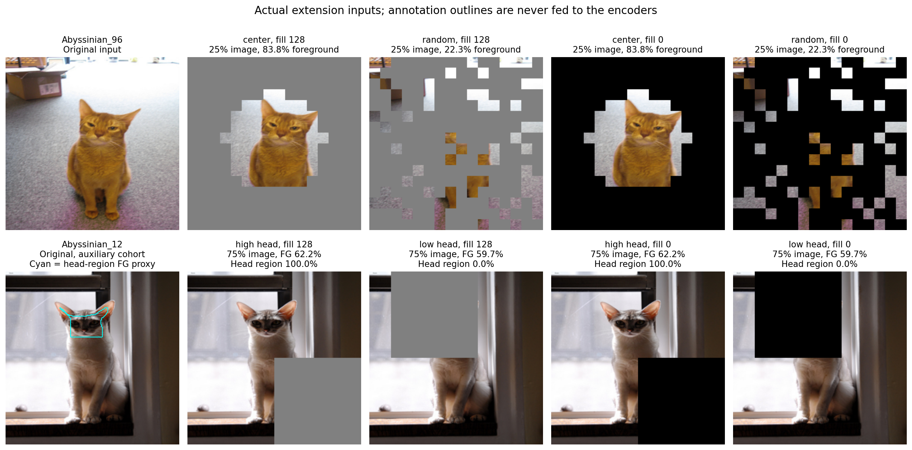
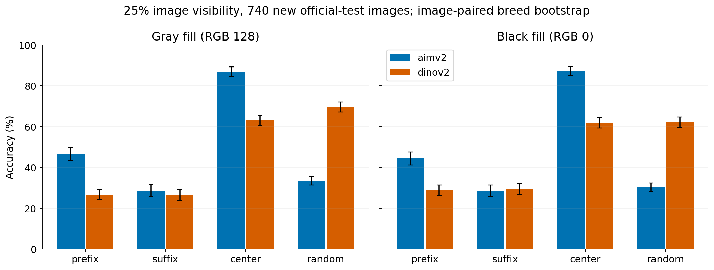
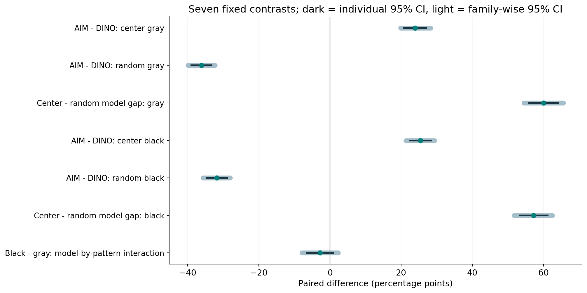
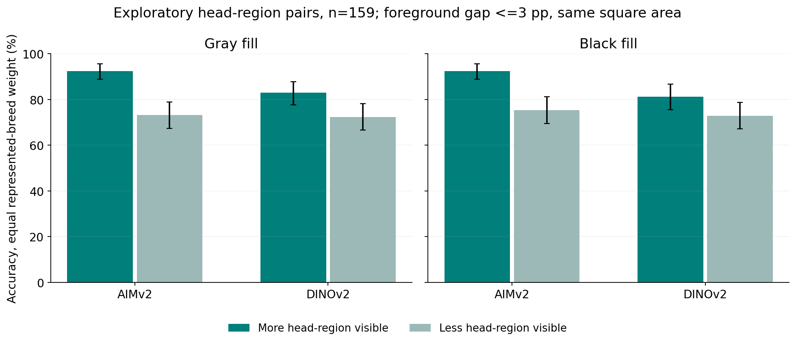

# 第二轮实验：新图片复查、填充敏感性与头部区域诊断

本轮方案由首轮结果启发，在新图片预测前固定并提交（815a33b）。它是预先固定的后续复查，不是独立构思的外部预注册研究。首轮 pilot_v1 保留不变。

## 先看结果

两种填充下，中心条件 AIMv2 更高、随机条件 DINOv2 更高的点估计排序均重复出现。 四个排序差值的同时置信区间也分别位于零的两侧。 这仍是特定数据、检查点、固定分类器和像素干预下的行为，不解释为训练机制差异。

## 做了什么

主实验：740 张此前未评估的官方测试图，每个品种 20 张；与首轮全部训练、验证和测试图在 ID 与原始图片字节哈希上不重叠。沿用原始 C=10 分类器和冻结编码器，完全没有重训或新参数选择。只聚焦 25% 图像可见预算，复查四种模式和三个随机重复，并重复同图方形遮挡诊断。每个遮挡版本都评估 RGB128 灰色与 RGB0 黑色，保留像素和位置相同。

辅助实验：185 张未用于原训练或验证、具有头框的官方 trainval 图片，独立于主实验。159/185 张满足事先规定的主体面积差不超过 3 个百分点、位置距离至少 4 个 patch、头部区域可见差至少 20 个百分点的配对条件。未放宽阈值或替换图片。本次官方标注归档中，测试集没有头框，因此辅助结果不能视作官方测试集的头部分析。

共 32,722 条真实预测，两个模型每个 16,361 条。原图是统计单位；随机重复先在图内平均。主实验按 37 个品种等权，10,000 次品种内图片 bootstrap；七个固定主对比同时报告单项和 Bonferroni 同时区间。辅助／配对筛选后也按有样本品种等权，原始联合计数另存，百分比不一定等于原始计数除以总数。

下图按样本清单顺序选例，未根据模型预测挑选；青色标注不传给编码器。

## 主实验：图像可见面积均为 25%

| Model | Fill RGB | Clean | Prefix 25% | Suffix 25% | Center 25% | Random 25% |
| --- | --- | --- | --- | --- | --- | --- |
| aimv2 | 128 | 93.5% | 46.6% | 28.6% | 87.0% | 33.6% |
| dinov2 | 128 | 84.6% | 26.6% | 26.5% | 63.1% | 69.6% |
| aimv2 | 0 | 93.5% | 44.5% | 28.5% | 87.3% | 30.4% |
| dinov2 | 0 | 84.6% | 28.8% | 29.3% | 61.9% | 62.2% |

| Pattern | Mean foreground visible | Median foreground visible | Original images |
| --- | --- | --- | --- |
| prefix | 9.6% | 8.1% | 740 |
| suffix | 15.3% | 12.6% | 740 |
| center | 62.5% | 60.2% | 740 |
| random | 25.0% | 25.0% | 740 |

| Contrast | Estimate pp | 95% CI pp | Family-wise 95% CI pp |
| --- | --- | --- | --- |
| aim_minus_dino_center_fill128 | 23.9 | [20.8, 27.0] | [19.9, 28.2] |
| aim_minus_dino_random_fill128 | -36.1 | [-38.9, -33.3] | [-39.9, -32.3] |
| center_minus_random_model_difference_fill128 | 60.0 | [56.0, 64.0] | [54.5, 65.6] |
| aim_minus_dino_center_fill0 | 25.4 | [22.4, 28.4] | [21.4, 29.3] |
| aim_minus_dino_random_fill0 | -31.8 | [-34.7, -28.9] | [-35.7, -28.0] |
| center_minus_random_model_difference_fill0 | 57.2 | [53.3, 61.2] | [51.7, 62.5] |
| black_minus_gray_model_by_pattern_interaction | -2.8 | [-6.4, 0.9] | [-7.9, 2.3] |

七个主对比中，center-minus-random 是模型差值在两种模式之间的变化，black-minus-gray 是这一交互量对填充颜色的敏感性。交互量非零本身不保证排序反转；需要分别看中心与随机的模型差值方向。

同样保留 25% 图像，center 平均保留了 62.5% 的主体，random 为 25.0%。上表主体覆盖度在两个模型和两种填充间完全相同，随机重复先在图内平均。这些标准模式保留了不同的主体分布；本轮没有估计其分数差异中有多少由主体或具体部位解释，不能把它当作已控制内容后的纯位置比较。

排序稳定不代表填充颜色无关。在 random 条件下，黑色减灰色的准确率差为 AIMv2 -3.2 个百分点，95% 区间 [-5.0, -1.4]；DINOv2 为 -7.4 个百分点，区间 [-9.2, -5.7]。模型与模式交互量的黑色减灰色差为 -2.8 个百分点，单项 95% 区间 [-6.4, 0.9]；该区间跨零并不证明两种填充等价。完整八项填充差值均保存在 fill_sensitivity.csv。

## 同图配对诊断

object_contrast 的 A/B 是主体保留较多／较少；visibility_matched 的 A/B 是算法固定的两个位置；head_contrast 的 A/B 是头部区域保留较多／较少。三个设计都固定图片、模型、分类器、遮挡形状和面积。配对遮挡保留的是 75% 图像，不能与上面保留 25% 图像的分数混用。

| Cohort | Pair | Model | Fill | n | A breed-macro accuracy | B breed-macro accuracy | A-B pp [95% CI] | Correctness flips | Class changes |
| --- | --- | --- | --- | --- | --- | --- | --- | --- | --- |
| auxiliary_head | head_contrast | aimv2 | 0 | 159 | 92.4% | 75.5% | 17.0 [11.3, 22.7] | 20.8% | 22.1% |
| auxiliary_head | head_contrast | aimv2 | 128 | 159 | 92.4% | 73.2% | 19.2 [13.5, 24.9] | 23.0% | 24.4% |
| auxiliary_head | head_contrast | dinov2 | 0 | 159 | 81.3% | 72.9% | 8.4 [4.1, 12.7] | 13.2% | 14.3% |
| auxiliary_head | head_contrast | dinov2 | 128 | 159 | 82.9% | 72.4% | 10.5 [5.8, 15.1] | 14.6% | 15.1% |
| primary | object_contrast | aimv2 | 0 | 740 | 92.3% | 67.3% | 25.0 [22.0, 28.1] | 25.8% | 29.1% |
| primary | visibility_matched | aimv2 | 0 | 740 | 85.0% | 90.9% | -5.9 [-8.1, -3.8] | 10.3% | 11.4% |
| primary | object_contrast | aimv2 | 128 | 740 | 92.8% | 67.2% | 25.7 [22.7, 28.8] | 25.9% | 28.6% |
| primary | visibility_matched | aimv2 | 128 | 740 | 84.9% | 90.1% | -5.3 [-7.6, -3.0] | 10.7% | 12.0% |
| primary | object_contrast | dinov2 | 0 | 740 | 83.1% | 65.5% | 17.6 [14.7, 20.4] | 20.5% | 25.7% |
| primary | visibility_matched | dinov2 | 0 | 740 | 77.7% | 80.0% | -2.3 [-4.3, -0.3] | 9.1% | 12.0% |
| primary | object_contrast | dinov2 | 128 | 740 | 82.6% | 67.2% | 15.4 [12.6, 18.2] | 20.0% | 24.7% |
| primary | visibility_matched | dinov2 | 128 | 740 | 78.9% | 80.1% | -1.2 [-3.1, 0.8] | 8.5% | 11.2% |

在辅助配对中，两边的主体可见面积平均为 55.9%／55.4%，但头部区域可见程度为 83.0%／12.7%。 其余主体区域可见程度则为 35.9%／85.7%。这些覆盖数值是原始图片均值，展示面积接近时仍可能发生较大的部位替换。

头部区域是“头框矩形与主体像素的交集”，属于区域代理，并非精确头部像素标注。即使主体总面积接近，头部、其余部位、背景和纹理仍作为内容组合一起改变；不能把准确率差解释成头部的独立因果效果。辅助头部实验也不能证明主实验的模型排序反转由头部可见性解释，两者使用不同的样本与遮挡设计。翻转率不能单独排名模型鲁棒性，两边都错不会产生正确性翻转。

## 它怎样回应教授

动机现在有可检验内容：评估条件是否改变模型排序，以及仅描述总可见面积或主体面积会遗漏什么。主实验使用未评估图片和另一种填充，检查首轮现象是否依赖小样本或单一灰色遮挡。辅助实验把部位可见程度变成可记录的变量，进一步诊断面积接近却内容不同的问题。

控制方面，同图配对固定了图片身份、遮挡面积／形状、模型与分类器；跨填充比较还固定可见像素。我们没有控制两个预训练模型的训练过程，因此跨模型结论始终是行为描述。原来 50% 图像预算缺乏共同主体覆盖支持的问题，本轮没有解决，也没有声称解决。

## 解释边界与下一步

本轮仍是单一数据集、两种合成常量填充、同一种 pooling、固定分类器。没有外部数据集复现，也没有包括分类器重训、模型检查点或协议选择的不确定性。排除了精确字节重复，未证明不存在视觉近重复或预训练重叠。辅助集的筛选和来源划分不同，不能与主实验合并作总体结论。已有前景／背景遮挡研究；本项目定位为复现与扩展，不声称首次发现。

下一步应依据本轮实际幅度和区间，决定优先核对特征读取方式、自然遮挡，还是更精细的部位标注，而不是把剩余差异归因于 prefix attention。完整协议、原始预测、固定分类器、输入指纹与审计均保留。AI 辅助范围见 docs/AI_USE.md，未提交 Canvas 或联系教师。

证据：[协议](../docs/EXTENSION_V2_PROTOCOL.md)、[主对比](../results/extension_v2/primary_contrasts.csv)、[配对统计](../results/extension_v2/paired_summary.csv)、[整体审计](../results/extension_v2/integration_audit.json)。
