# Occlusion, visible animal area, and model performance

Updated November 10, 2026. Frozen AIMv2 and DINOv2 on Oxford-IIIT Pet. This report is generated from saved, audited predictions.

## Status

- Foreground-conditioned reanalysis of existing results: complete.
- 50%/75% primary-cohort extension: complete.
- Previously unused 185-image annotated cohort: complete.
- The encoders, clean-trained classifiers, mean pooling, and original results are unchanged.

## Question

How does model performance depend on the masking pattern, the amount of animal foreground that remains visible, and the animal regions retained? Image visibility and animal visibility use different denominators. Equal image visibility does not guarantee equal animal coverage, and equal animal coverage does not guarantee equal content.

## Main findings

- The center/random reversal depends on the visibility budget. With gray fill, the random-mask AIM-minus-DINO gap changes from -36.1 pp at 25% image visibility to -6.0 pp at 50%, then +5.4 pp at 75%. Center favors AIMv2 at all three budgets. These component signs are resolved by the prespecified approximate simultaneous intervals.
- At 75% image visibility, AIMv2 leads under both center and random masks with both fills. The original reversal therefore describes strong occlusion conditions, not a universal split between the models.
- Fill color matters near the transition. At 50% visibility with black random masks, the gap is -0.8 pp, with simultaneous interval [-4.6, +2.9]. This does not resolve a winner, whereas the gray-fill contrast favors DINOv2.
- Foreground-conditioned curves have limited overlap. Their remaining pattern differences are descriptive associations; sharing a visibility bin does not hold image identity or visible content fixed.

### Check on previously unused images

The 185-image annotated cohort again resolves the center/random reversal at 25% image visibility with both fills. At 75%, both center and random point estimates favor AIMv2, but the random-mask simultaneous intervals include zero for both fills. The new cohort is consistent with the primary direction; it does not independently resolve the full 75% ordering. At 50%, the random-mask simultaneous intervals also include zero.
Among 164 eligible new head pairs, mean animal visibility is 55.4% versus 55.0%, while mean head coverage is 83.0% versus 15.7%. Gray-fill accuracy is 92.1% versus 77.1% for AIMv2, and 85.2% versus 78.6% for DINOv2. The corresponding content-bundle gaps are 15.0 and 6.6 pp. These retain the earlier direction, with smaller gaps; other animal regions change alongside the head.

## Clean accuracy changes the interpretation

Each original image contributes its clean correctness minus its average masked correctness. A positive loss means fewer correct breed predictions after masking. The gap in losses subtracts the DINOv2 loss from the AIMv2 loss. Both models see the same images and random masks.

Gray random masking with 75% image visibility on the main 740 images.

| Model | Clean accuracy | Masked accuracy | Net loss (pp) | Accuracy among images both classified correctly when clean |
| --- | --- | --- | --- | --- |
| aimv2 | 93.5% | 87.9% | 5.6 | 95.3% |
| dinov2 | 84.6% | 82.5% | 2.1 | 95.4% |

AIMv2 finishes with higher accuracy and loses 3.6 pp more from its clean baseline (adjusted 95% interval 0.6 to 6.6 pp). On the 613 images both models originally got right, their retained accuracies are close. This subset excludes initial errors, so it answers a different question from the full-sample net loss.

The corresponding loss difference on the 185 annotated images is 4.5 pp (adjusted interval -0.2 to 9.4 pp). The follow-up comparisons are exploratory. [All 48 conditions](../results/occlusion_completion/clean_loss.csv) and [analysis rules](../docs/FINAL_SENSITIVITY.md).

## Moving visible patches at matched animal area

Of the 740 main images, only 8, 2, 14 respectively had an existing uniform random mask within three percentage points of the center mask at 25%, 50%, and 75% image visibility. The design required at least 20 for a subset estimate. [Pair counts and support](../results/occlusion_completion/area_matched_patterns.csv).

We then generated two new masks per eligible image. Starting from the 25% center condition, each new mask keeps the same number of patches in each animal-coverage band, moves at least 16 of 64 patches, and preserves the fraction of animal visible within three percentage points. We scored both masks and a center replay with gray fill. These annotation-guided masks represent a different intervention from uniform random patches.

| Cohort | Measure | Eligible | Center | Relocated | Difference (pp) | Adjusted 95% interval (pp) |
| --- | --- | --- | --- | --- | --- | --- |
| new_head | aimv2 | 182/185 | 86.8% | 72.0% | +14.8 | [+8.5, +21.2] |
| new_head | dinov2 | 182/185 | 59.9% | 77.5% | -17.6 | [-23.9, -11.6] |
| new_head | interaction | 182/185 | — | — | +32.4 | [+24.2, +40.9] |
| primary | aimv2 | 731/740 | 87.0% | 72.4% | +14.6 | [+11.5, +17.8] |
| primary | dinov2 | 731/740 | 63.3% | 75.9% | -12.5 | [-15.9, -9.2] |
| primary | interaction | 731/740 | — | — | +27.2 | [+22.5, +32.0] |

For each model, difference is center accuracy minus relocated accuracy. Interaction is the AIMv2 difference minus the DINOv2 difference. Intervals use paired original images and adjust for these three comparisons within each cohort.

In the new_head cohort, mean animal visibility is 60.3% for center and 60.0% after relocation. The relocated versions exchange an average of 31.9 of the 64 visible patches.
In the primary cohort, mean animal visibility is 62.3% for center and 62.0% after relocation. The relocated versions exchange an average of 32.0 of the 64 visible patches.

On the main images, moving the patches reduces AIMv2 accuracy by 14.6 pp and increases DINOv2 accuracy by 12.5 pp. The difference in responses is 27.2 pp (adjusted 95% interval 22.5 to 32.0). The annotated cohort shows the same directions, with a difference in responses of 32.4 pp.

The comparison measures sensitivity to this change in visible content and arrangement at closely matched animal area. Patch adjacency, texture, animal parts and background pixels can change together. Both cohorts have appeared in earlier experiments. [Design and execution](../docs/PATCH_RELOCATION.md) and [full results](../results/patch_relocation/summary.csv).

## Two tests on fresh official test photos

All previous project image IDs and exact JPEG hashes were excluded before selecting these photos. The direct replication sampled ten new images per breed. Of 370 sampled, 364 supported the original relocation rule. The regional experiment required four visible and four hidden pure patches in each of animal and background. 779 of 2737 candidate photos qualified. Up to ten per breed gave 366 regional photos. The samples share 88 images. Estimates give equal weight to each of the 37 breeds.

The direct replication used the previous design, with two fixed relocations per eligible image. Differences below use center accuracy minus relocated accuracy. Each interval adjusts for the two models within this comparison.

| Model | Center | Relocated | Center minus relocated (pp) | Adjusted 95% interval (pp) |
| --- | --- | --- | --- | --- |
| aimv2 | 87.9% | 72.4% | +15.5 | [+11.8, +19.3] |
| dinov2 | 63.4% | 75.5% | -12.2 | [-16.3, -8.0] |

For the regional experiment, each single-region change hides four visible patches and reveals four others from the same region. The original pixels keep their positions. Other regions, mixed patches, fill color, image budget and the exact visible pixel counts of each trimap class are fixed. The combined condition applies both exchanges.

| Model | Center | Animal swap | Background swap | Both swaps | Animal minus background cost (pp) | Adjusted 95% interval (pp) |
| --- | --- | --- | --- | --- | --- | --- |
| aimv2 | 84.0% | 82.3% | 82.0% | 80.2% | -0.3 | [-3.6, +3.2] |
| dinov2 | 57.7% | 64.4% | 60.1% | 67.4% | -4.3 | [-8.0, -0.6] |

Each regional cost averages the change from applying its swap at both settings of the other region. The difference between costs reduces to background-only accuracy minus animal-only accuracy. A positive difference means the animal exchange cost more accuracy. A negative difference means it cost less. A range spanning zero leaves the ordering uncertain. The full table includes both costs, the factorial interaction and pointwise intervals.

Only photos with enough pure animal and background patches near and outside the center support this experiment. It tests small exchanges, with one regional draw per photo. It does not recover causal contributions to the larger relocation or identify a pretraining mechanism. Prior research has already separated foreground and background cues in recognition. The contribution here is the paired, equal-size intervention in the two fixed Pet classifiers and its comparison with the earlier behavior. [Xiao et al.](https://openreview.net/pdf?id=gl3D-xY7wLq), [locked design](../docs/REGION_SWAP_PROTOCOL.md), [estimates and intervals](../results/region_swap/summary.csv).

AIMv2 accuracy after an animal-only exchange minus accuracy after a background-only exchange was +0.3 pp (adjusted interval -3.2 to +3.6).
DINOv2 accuracy after an animal-only exchange minus accuracy after a background-only exchange was +4.3 pp (adjusted interval +0.6 to +8.0).

DINOv2 gained more accuracy when the exchange involved animal patches. AIMv2 showed no resolved difference between the two exchange locations. This locates a behavioral difference under an exact area constraint. Within each region the particular texture, part and position can still change.

## Accuracy across masking conditions

### primary

Clean-image accuracy: AIMv2 93.5%; DINOv2 84.6%. The tables compare absolute accuracy under occlusion, not a clean-normalized robustness score. The clean baselines already differ.

| Image visible | Fill | Pattern | AIMv2 | DINOv2 | AIM minus DINO, pp [95% CI] | Mean animal visible | Images |
| --- | --- | --- | --- | --- | --- | --- | --- |
| 25% | Black | center | 87.3% | 61.9% | +25.4 [+22.4, +28.4] | 62.5% | 740 |
| 25% | Black | prefix | 44.5% | 28.8% | +15.7 [+12.3, +18.9] | 9.6% | 740 |
| 25% | Black | random | 30.4% | 62.2% | -31.8 [-34.5, -29.0] | 25.0% | 740 |
| 25% | Black | suffix | 28.5% | 29.3% | -0.8 [-4.1, +2.4] | 15.3% | 740 |
| 25% | Gray | center | 87.0% | 63.1% | +23.9 [+20.8, +26.9] | 62.5% | 740 |
| 25% | Gray | prefix | 46.6% | 26.6% | +20.0 [+16.6, +23.4] | 9.6% | 740 |
| 25% | Gray | random | 33.6% | 69.6% | -36.1 [-38.9, -33.3] | 25.0% | 740 |
| 25% | Gray | suffix | 28.6% | 26.5% | +2.2 [-0.9, +5.4] | 15.3% | 740 |
| 50% | Black | center | 92.7% | 79.1% | +13.6 [+11.2, +16.1] | 86.4% | 740 |
| 50% | Black | prefix | 86.4% | 67.4% | +18.9 [+15.9, +21.8] | 46.4% | 740 |
| 50% | Black | random | 75.7% | 76.5% | -0.8 [-3.4, +1.8] | 49.9% | 740 |
| 50% | Black | suffix | 70.8% | 65.9% | +4.9 [+1.6, +8.1] | 53.6% | 740 |
| 50% | Gray | center | 92.8% | 79.3% | +13.5 [+10.9, +16.1] | 86.4% | 740 |
| 50% | Gray | prefix | 86.4% | 69.3% | +17.0 [+14.3, +19.7] | 46.4% | 740 |
| 50% | Gray | random | 73.4% | 79.4% | -6.0 [-8.6, -3.5] | 49.9% | 740 |
| 50% | Gray | suffix | 68.6% | 65.0% | +3.6 [+0.4, +6.9] | 53.6% | 740 |
| 75% | Black | center | 94.1% | 84.2% | +9.9 [+7.6, +12.3] | 95.8% | 740 |
| 75% | Black | prefix | 93.5% | 82.6% | +10.9 [+8.5, +13.4] | 84.7% | 740 |
| 75% | Black | random | 88.6% | 80.8% | +7.9 [+5.5, +10.3] | 74.9% | 740 |
| 75% | Black | suffix | 92.4% | 82.6% | +9.9 [+7.3, +12.4] | 90.4% | 740 |
| 75% | Gray | center | 93.8% | 84.6% | +9.2 [+6.8, +11.8] | 95.8% | 740 |
| 75% | Gray | prefix | 93.9% | 81.9% | +12.0 [+9.7, +14.5] | 84.7% | 740 |
| 75% | Gray | random | 87.9% | 82.5% | +5.4 [+3.1, +7.6] | 74.9% | 740 |
| 75% | Gray | suffix | 92.3% | 83.2% | +9.1 [+6.6, +11.6] | 90.4% | 740 |

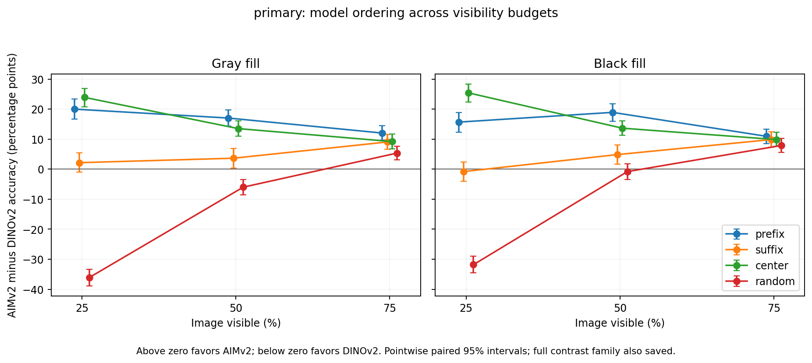

### new_head

Clean-image accuracy: AIMv2 96.2%; DINOv2 88.6%. The tables compare absolute accuracy under occlusion, not a clean-normalized robustness score. The clean baselines already differ.

| Image visible | Fill | Pattern | AIMv2 | DINOv2 | AIM minus DINO, pp [95% CI] | Mean animal visible | Images |
| --- | --- | --- | --- | --- | --- | --- | --- |
| 25% | Black | center | 88.1% | 65.9% | +22.2 [+16.8, +27.6] | 60.7% | 185 |
| 25% | Black | prefix | 38.9% | 29.2% | +9.7 [+2.7, +16.8] | 9.2% | 185 |
| 25% | Black | random | 33.5% | 67.7% | -34.2 [-39.5, -29.0] | 25.0% | 185 |
| 25% | Black | suffix | 32.4% | 36.2% | -3.8 [-10.3, +2.2] | 16.3% | 185 |
| 25% | Gray | center | 87.0% | 60.0% | +27.0 [+21.6, +32.4] | 60.7% | 185 |
| 25% | Gray | prefix | 40.0% | 28.6% | +11.4 [+4.9, +17.8] | 9.2% | 185 |
| 25% | Gray | random | 33.3% | 74.6% | -41.3 [-46.7, -35.9] | 25.0% | 185 |
| 25% | Gray | suffix | 31.4% | 36.2% | -4.9 [-11.4, +1.1] | 16.3% | 185 |
| 50% | Black | center | 94.1% | 81.1% | +13.0 [+8.6, +17.3] | 85.0% | 185 |
| 50% | Black | prefix | 87.6% | 71.9% | +15.7 [+10.8, +20.5] | 45.5% | 185 |
| 50% | Black | random | 79.5% | 82.5% | -3.1 [-7.7, +1.4] | 49.8% | 185 |
| 50% | Black | suffix | 80.0% | 71.9% | +8.1 [+2.2, +14.1] | 54.5% | 185 |
| 50% | Gray | center | 95.1% | 80.5% | +14.6 [+10.3, +18.9] | 85.0% | 185 |
| 50% | Gray | prefix | 87.6% | 70.3% | +17.3 [+12.4, +22.7] | 45.5% | 185 |
| 50% | Gray | random | 78.2% | 83.4% | -5.2 [-9.9, -0.5] | 49.8% | 185 |
| 50% | Gray | suffix | 77.8% | 70.8% | +7.0 [+1.6, +12.4] | 54.5% | 185 |
| 75% | Black | center | 96.8% | 86.5% | +10.3 [+5.9, +14.6] | 95.2% | 185 |
| 75% | Black | prefix | 94.6% | 85.9% | +8.6 [+4.3, +13.0] | 83.7% | 185 |
| 75% | Black | random | 90.1% | 86.5% | +3.6 [-0.2, +7.4] | 74.9% | 185 |
| 75% | Black | suffix | 94.6% | 88.1% | +6.5 [+2.7, +10.8] | 90.8% | 185 |
| 75% | Gray | center | 95.7% | 85.9% | +9.7 [+5.4, +14.1] | 95.2% | 185 |
| 75% | Gray | prefix | 95.1% | 83.8% | +11.4 [+7.6, +15.7] | 83.7% | 185 |
| 75% | Gray | random | 91.2% | 88.1% | +3.1 [-1.1, +7.4] | 74.9% | 185 |
| 75% | Gray | suffix | 94.6% | 83.2% | +11.4 [+7.0, +16.2] | 90.8% | 185 |

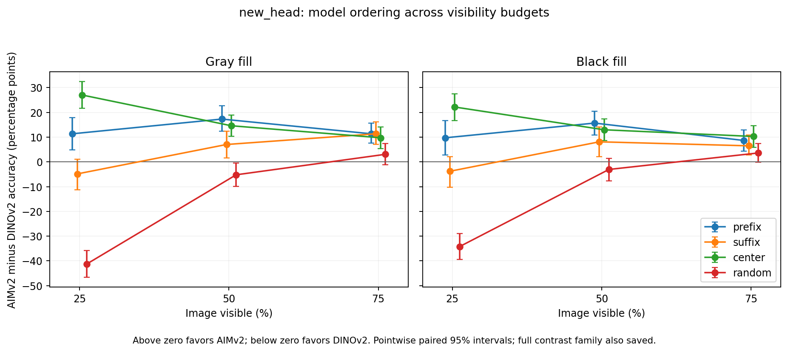

The intervals above are paired, pointwise image-bootstrap intervals. Random-mask repeats are averaged within each original image. `accuracy_summary.csv` also reports approximate simultaneous intervals for the 12 center/random model-gap contrasts within each cohort. The two cohorts are not pooled.

### Where the center/random ordering reverses

| Cohort | Image visible | Fill | Center gap (pp) | Random gap (pp) | Opposite point-estimate signs | Both signs resolved by simultaneous intervals |
| --- | --- | --- | --- | --- | --- | --- |
| new_head | 25% | Black | +22.2 | -34.2 | Yes | Yes |
| new_head | 25% | Gray | +27.0 | -41.3 | Yes | Yes |
| new_head | 50% | Black | +13.0 | -3.1 | Yes | No |
| new_head | 50% | Gray | +14.6 | -5.2 | Yes | No |
| new_head | 75% | Black | +10.3 | +3.6 | No | No |
| new_head | 75% | Gray | +9.7 | +3.1 | No | No |
| primary | 25% | Black | +25.4 | -31.8 | Yes | Yes |
| primary | 25% | Gray | +23.9 | -36.1 | Yes | Yes |
| primary | 50% | Black | +13.6 | -0.8 | Yes | No |
| primary | 50% | Gray | +13.5 | -6.0 | Yes | Yes |
| primary | 75% | Black | +9.9 | +7.9 | No | Yes |
| primary | 75% | Gray | +9.2 | +5.4 | No | Yes |

The last column asks whether each gap has a definite sign, regardless of whether those signs agree. The intervals cover the 12 center and random comparisons within a cohort.

## Foreground-conditioned accuracy

Each panel holds image visibility, fill, and masking pattern fixed. The horizontal axis measures the fraction of the photographed animal that remains visible. The vertical axis is breed-classification accuracy. Curves describe different image groups; moving along a curve is not an intervention that reveals more of the same animal.

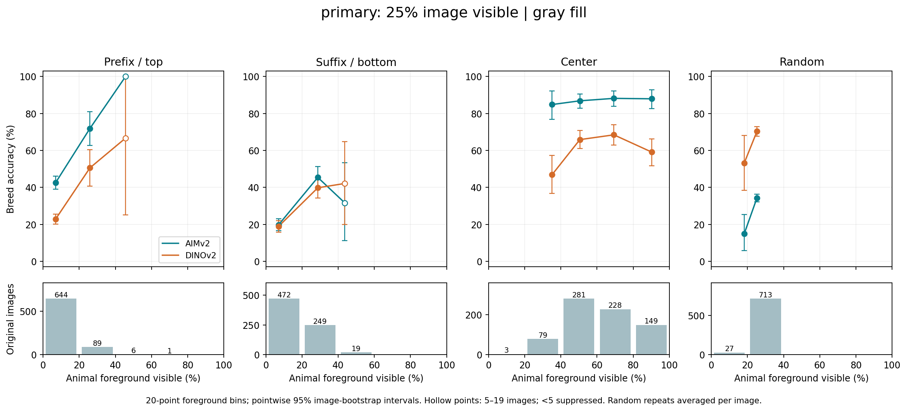

[Black-fill version](../results/occlusion_completion/figures/primary_foreground_25_fill0.png)

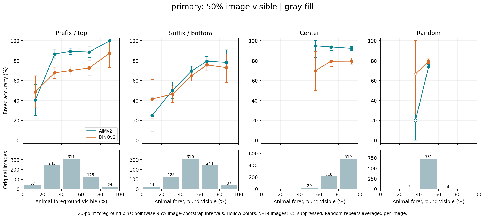

[Black-fill version](../results/occlusion_completion/figures/primary_foreground_50_fill0.png)

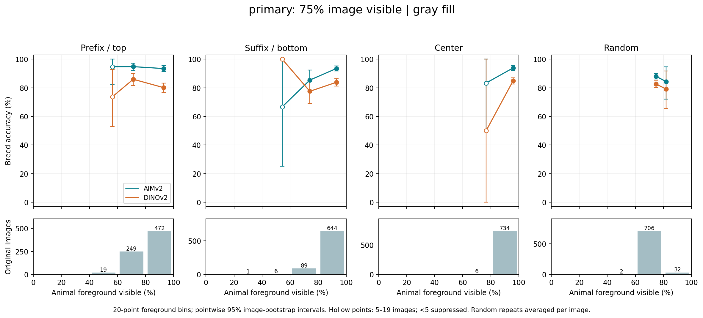

[Black-fill version](../results/occlusion_completion/figures/primary_foreground_75_fill0.png)

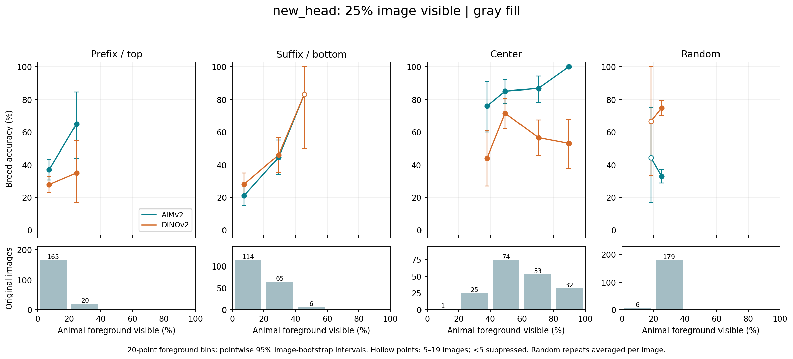

[Black-fill version](../results/occlusion_completion/figures/new_head_foreground_25_fill0.png)

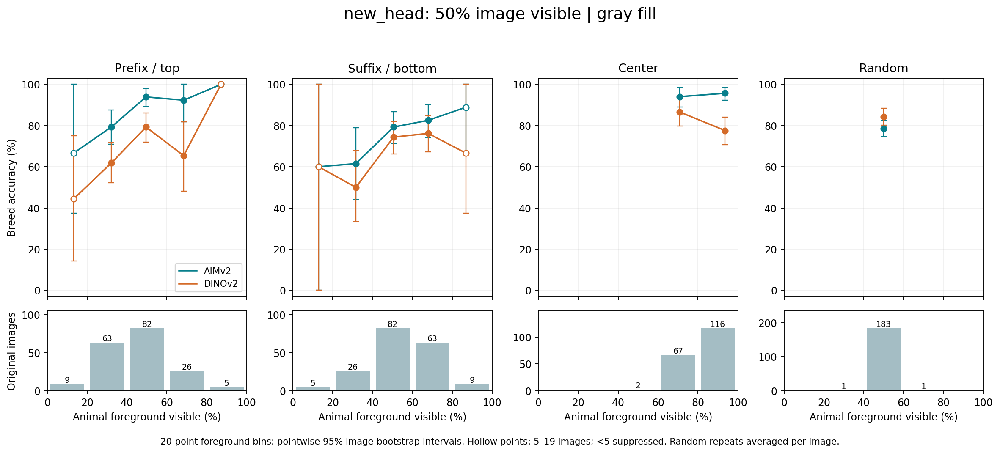

[Black-fill version](../results/occlusion_completion/figures/new_head_foreground_50_fill0.png)

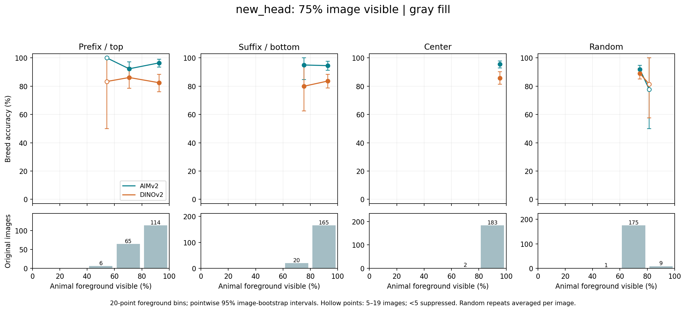

[Black-fill version](../results/occlusion_completion/figures/new_head_foreground_75_fill0.png)

Counts below each panel are original images, not the number of mask repetitions. Hollow points have 5–19 images; estimates with fewer than five are suppressed. Empty regions are not extrapolated. Intervals are pointwise; an all-correct sparse cell can have a degenerate empirical bootstrap interval, which does not establish certainty about unseen images.

Main bins average random-mask coverage and correctness within image before binning. The saved `individual_repeats` sensitivity table instead bins each mask, gives each repeat weight 1/3, and retains image-level bootstrap clustering. The two conventions answer slightly different conditional questions.

## Overlap limits the pattern comparison

| Cohort | Image visible | Bin width | Pattern | Common bin indices (from zero) | Retained images | Standardized model gap (pp) |
| --- | --- | --- | --- | --- | --- | --- |
| new_head | 25% | 10% | prefix | None | 0/185 | Not estimable |
| new_head | 25% | 10% | suffix | None | 0/185 | Not estimable |
| new_head | 25% | 10% | center | None | 0/185 | Not estimable |
| new_head | 25% | 10% | random | None | 0/185 | Not estimable |
| new_head | 25% | 20% | prefix | 1 | 20/185 | +30.0 |
| new_head | 25% | 20% | suffix | 1 | 65/185 | -1.5 |
| new_head | 25% | 20% | center | 1 | 25/185 | +32.0 |
| new_head | 25% | 20% | random | 1 | 179/185 | -41.9 |
| new_head | 50% | 10% | prefix | None | 0/185 | Not estimable |
| new_head | 50% | 10% | suffix | None | 0/185 | Not estimable |
| new_head | 50% | 10% | center | None | 0/185 | Not estimable |
| new_head | 50% | 10% | random | None | 0/185 | Not estimable |
| new_head | 50% | 20% | prefix | None | 0/185 | Not estimable |
| new_head | 50% | 20% | suffix | None | 0/185 | Not estimable |
| new_head | 50% | 20% | center | None | 0/185 | Not estimable |
| new_head | 50% | 20% | random | None | 0/185 | Not estimable |
| new_head | 75% | 10% | prefix | 8 | 38/185 | +10.5 |
| new_head | 75% | 10% | suffix | 8 | 58/185 | +10.3 |
| new_head | 75% | 10% | center | 8 | 39/185 | +0.0 |
| new_head | 75% | 10% | random | 8 | 9/185 | -3.7 |
| new_head | 75% | 20% | prefix | 4 | 114/185 | +14.0 |
| new_head | 75% | 20% | suffix | 4 | 165/185 | +10.9 |
| new_head | 75% | 20% | center | 4 | 183/185 | +9.8 |
| new_head | 75% | 20% | random | 4 | 9/185 | -3.7 |
| primary | 25% | 10% | prefix | 2;3 | 89/740 | +12.9 |
| primary | 25% | 10% | suffix | 2;3 | 249/740 | +4.6 |
| primary | 25% | 10% | center | 2;3 | 79/740 | +45.9 |
| primary | 25% | 10% | random | 2;3 | 713/740 | -40.1 |
| primary | 25% | 20% | prefix | 1 | 89/740 | +21.3 |
| primary | 25% | 20% | suffix | 1 | 249/740 | +5.6 |
| primary | 25% | 20% | center | 1 | 79/740 | +38.0 |
| primary | 25% | 20% | random | 1 | 713/740 | -36.0 |
| primary | 50% | 10% | prefix | 5 | 124/740 | +15.3 |
| primary | 50% | 10% | suffix | 5 | 186/740 | +4.8 |
| primary | 50% | 10% | center | 5 | 18/740 | +22.2 |
| primary | 50% | 10% | random | 5 | 366/740 | -0.7 |
| primary | 50% | 20% | prefix | 2 | 311/740 | +19.3 |
| primary | 50% | 20% | suffix | 2 | 310/740 | +4.8 |
| primary | 50% | 20% | center | 2 | 20/740 | +25.0 |
| primary | 50% | 20% | random | 2 | 731/740 | -5.5 |
| primary | 75% | 10% | prefix | 7;8 | 305/740 | +8.4 |
| primary | 75% | 10% | suffix | 7;8 | 279/740 | +8.4 |
| primary | 75% | 10% | center | 7;8 | 124/740 | +9.5 |
| primary | 75% | 10% | random | 7;8 | 710/740 | +5.3 |
| primary | 75% | 20% | prefix | 3;4 | 721/740 | +12.6 |
| primary | 75% | 20% | suffix | 3;4 | 733/740 | +9.3 |
| primary | 75% | 20% | center | 3;4 | 740/740 | +12.8 |
| primary | 75% | 20% | random | 3;4 | 738/740 | +5.2 |

These descriptive summaries use the same foreground-bin weights for all four patterns, proportional to the minimum count across patterns. They restrict the population, do not match image identity, and do not eliminate within-bin visibility or composition differences. No causal or uncertainty-based claim is made from these standardized point estimates.

For example, in the original 20–40% foreground bin, center has 79 images with mean foreground visibility 35.1%; random has 713 images with mean 25.2%. A shared broad-bin label is not exact matching. Ten-point bins are reported as a prespecified sensitivity analysis, not chosen to obtain a desired ordering.

## Retained animal regions

| Cohort | Model | Pairs | Animal visible | Head ROI visible | Other animal visible | Background visible | Accuracy | Accuracy gap, pp [95% CI] |
| --- | --- | --- | --- | --- | --- | --- | --- | --- |
| auxiliary_head | aimv2 | 159 | 55.9% / 55.4% | 83.0% / 12.7% | 35.9% / 85.7% | 86.5% / 86.2% | 92.4% / 73.2% | 19.2 [13.7, 24.9] |
| auxiliary_head | dinov2 | 159 | 55.9% / 55.4% | 83.0% / 12.7% | 35.9% / 85.7% | 86.5% / 86.2% | 82.9% / 72.4% | 10.5 [5.9, 15.1] |
| new_head | aimv2 | 164 | 55.4% / 55.0% | 83.0% / 15.7% | 35.5% / 84.1% | 87.5% / 87.3% | 92.1% / 77.1% | 15.0 [9.8, 20.3] |
| new_head | dinov2 | 164 | 55.4% / 55.0% | 83.0% / 15.7% | 35.5% / 84.1% | 87.5% / 87.3% | 85.2% / 78.6% | 6.6 [2.8, 10.5] |

Values before/after the slash correspond to higher/lower head coverage. Region percentages are image averages; paired accuracy estimates weight represented breeds equally, matching the original head-pair analysis. Each visibility percentage uses its own original region as the denominator: head and other-animal visibility are not shares that add to 100%. Head ROI is the annotated head box intersected with animal foreground. “Other animal” is its complement, not a precise body-part segmentation.

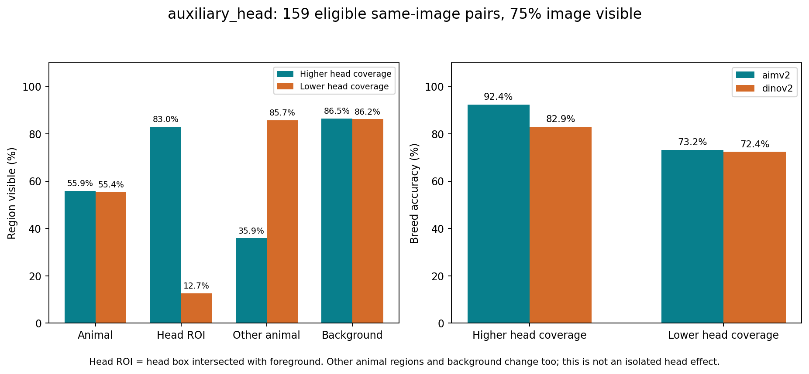

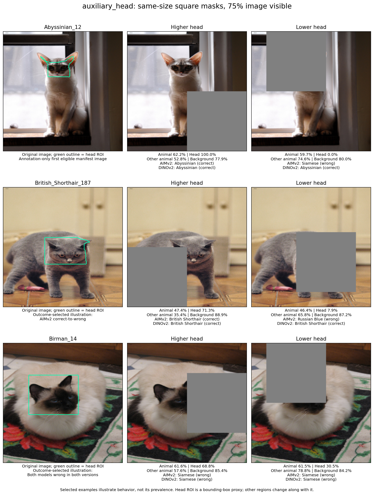

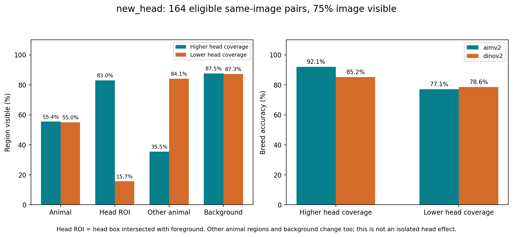

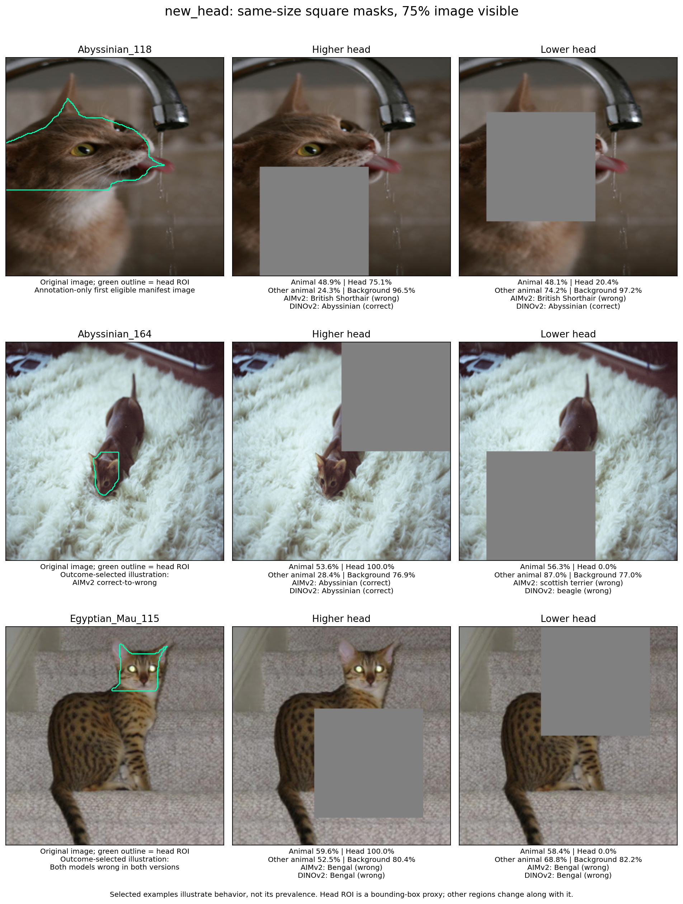

The matched foreground rule applies to every selected pair, within three percentage points. It does not fix which pixels, textures, or background regions remain. Higher head coverage exchanges visible head-region pixels for other animal pixels. These results characterize a changed content bundle; they do not isolate a causal head effect or explain the main center/random comparison by themselves.

The new cohort contains all 185 independently selected annotated images for standard-pattern evaluation, including those ineligible for a head pair. 164 of 185 satisfy the unchanged pair rule. The cohort comes from unused official trainval images because the downloaded official test split lacks head-box XMLs. It is disjoint from prior training, validation, and evaluation IDs and exact image hashes. This is a new-image scope check with a different source split, not an identical-population replication.

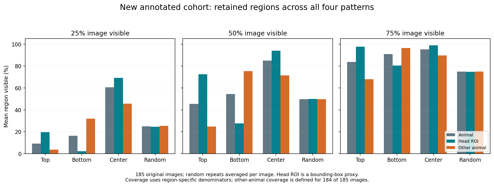

One new-cohort image has no foreground outside its head box. Its other-animal visibility is undefined, rather than zero; the standard-region table reports the measurement count for every region. All 185 images remain in standard accuracy evaluation.

`head_thirds.csv` reports head-coverage thirds within foreground bin, pattern, budget, and fill. Only seven of the twelve pattern-by-budget groups contain any foreground bin with at least two head thirds supported by five or more images each. These are still different image groups within broad intervals. Sparse cells are suppressed; missing cells cannot be used to establish an independent head effect.

## What can be concluded

- Report robustness for explicit masking conditions, not as a universal ordering of pretrained models.
- Report foreground visibility alongside the image mask budget: the same image budget can retain very different amounts of animal.
- Foreground-area conditioning must show overlap and sample sizes. Residual pattern differences are associations under this evaluation, not proof of a pure position or training effect.
- Describe retained region bundles explicitly. Similar foreground area does not hold semantic content fixed.

The frozen classifiers, pooling, synthetic fill masks, one fine-grained dataset, annotation proxies, and different pretraining histories limit generalization. The primary extension reuses previously analyzed images. The new head cohort is separately reported. No pooling ablation, internal mechanism claim, or improved breed classifier is part of this study.

## Relation to earlier work

[Naseer et al., Intriguing Properties of Vision Transformers](https://arxiv.org/html/2105.10497v3) study transformer robustness using random, salient, and non-salient patch occlusions. Occlusion evaluation itself is therefore established; this project contributes a bounded comparison of two later fixed encoder/probe systems with explicit foreground measurements and overlap checks.

[Kassaw et al., Image Recognition Under Occlusion](https://arxiv.org/html/2409.10775v1) evaluate real and synthetic occlusion and discuss diffuse occlusion. Their work motivates checking more than one occlusion condition. This project uses artificial pixel fills on Pet images and does not establish performance under real occluders.

## Reproduction and checks

Use the decoder-pinned reference environment from the repository. The completion runner refuses changed preparation locks, replays eight original conditions per model, verifies transformed-input fingerprints, binds caches to models/classifiers/configuration, and reconstructs predictions from saved features. The analysis independently reproduces the previous headline scores and validates one-to-one shared-condition joins.

```bash
source scripts/env.sh
.reference-conda/bin/python scripts/complete_occlusion.py prepare --cohort primary
.reference-conda/bin/python scripts/complete_occlusion.py prepare --cohort head
# For each cohort and each model, run and audit as in scripts/run_completion.sh.
OPENBLAS_NUM_THREADS=4 .reference-conda/bin/python scripts/analyze_completion.py
.reference-conda/bin/python scripts/completion_examples.py
.reference-conda/bin/python scripts/verify_completion.py
.reference-conda/bin/python scripts/report_completion.py
```

The fixed design is in `docs/OCCLUSION_COMPLETION_PROTOCOL.md`; stage planning is in `docs/OCCLUSION_COMPLETION_PLAN.md`. Source tables and figures are under `results/occlusion_completion/`. Codex assisted protocol implementation, execution, analysis, and documentation under the existing AI-use disclosure.
