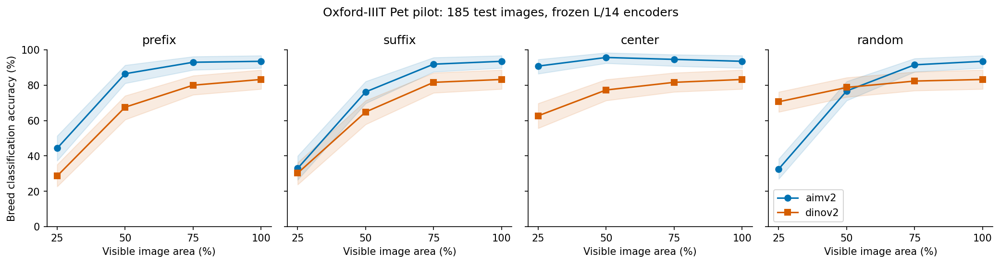
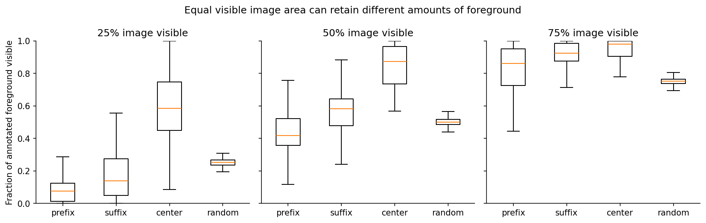
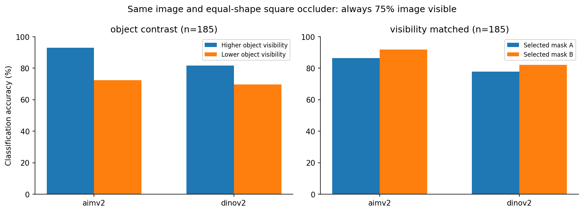

# Object-visibility-aware occlusion evaluation: pilot v1

Executed 2026-10-18. All numbers below come from saved model predictions, not examples or literature scores.

## Initial results

| Model | Clean | Prefix 50% | Suffix 50% | Center 50% | Random 50% |
| --- | ---: | ---: | ---: | ---: | ---: |
| aimv2 | 93.5% | 86.5% | 76.2% | 95.7% | 76.8% |
| dinov2 | 83.2% | 67.6% | 64.9% | 77.3% | 78.7% |

A descriptive ordering change appears at 25% visible area: under random masks, AIMv2 reaches 32.6% and DINOv2 70.6%; the paired AIMv2-minus-DINOv2 difference is -38.0 percentage points (95% image-bootstrap CI -45.0 to -31.4). Under center-nearest visibility at the same image-area budget, AIMv2 reaches 90.8% and DINOv2 62.7%. These conditions retain different foreground distributions. This is a checkpoint-and-probe-specific pattern, not a pretraining-causality finding or a general model ranking.

At the same 50% visible image area, the center-nearest mask preserves an average 85.2% of labeled foreground versus 50.2% for the random condition. This is an input-composition finding, not by itself a new model-robustness result.

- **aimv2:** same-image square occluders with higher/lower object visibility yield 93.0% / 72.4% accuracy; paired difference 20.5 percentage points (95% image-bootstrap CI 14.6 to 27.0). In 185 foreground-visibility-matched image pairs, correctness differs for 11.9% and predicted class differs for 11.9%. Maximum foreground-coverage mismatch is 3.0 percentage points.
- **dinov2:** same-image square occluders with higher/lower object visibility yield 81.6% / 69.7% accuracy; paired difference 11.9 percentage points (95% image-bootstrap CI 6.5 to 17.3). In 185 foreground-visibility-matched image pairs, correctness differs for 9.7% and predicted class differs for 13.5%. Maximum foreground-coverage mismatch is 3.0 percentage points.

Exploratory standardization: 16 pattern estimates have the prespecified common-bin support. Non-estimable visible-image budgets: 50%. At supported budgets, the retained groups can still be small; consult visibility_standardization.csv and visibility_bin_counts.csv for bins and counts. These coarse-bin descriptive estimates do not equal exact foreground matching or causal mediation.

## Design and interpretation

The pilot uses 1,480 training, 370 validation and 185 official-test images across 37 Oxford-IIIT Pet breeds. Fourteen invalid empty-foreground annotations were excluded before sampling (7 official trainval, 7 test). Both frozen L/14 encoders use mean final patch pooling plus L2 normalization, and separate clean-only logistic classifiers. C is chosen using clean validation labels only. Test labels never select masks or hyperparameters.

Both original validation searches selected C=10, the upper boundary of the prespecified grid. The labeled post-hoc supplement explores C=10,100,1000 while retaining all original main estimates. Pooling and wider probe choices remain unresolved; these scores do not rank general encoder quality. The shared mean-patch recipe can suit the encoders differently.

Visible area is 100/75/50/25%; patterns are raster prefix, suffix, center-nearest and three deterministic random repetitions. Hidden pixels use RGB 128 and no tokens are removed. Same-image square-occluder pairs fix hidden area to 25% and shape to 8x8 patches. Matched pairs differ by at most 0.03 in foreground visibility and are selected from annotations without model outputs.

This is a diagnostic replication/extension of existing foreground/background occlusion work, not a new general principle or a causal test of prefix attention. Shared pooling is a controlled diagnostic choice, not each model's published best evaluation recipe. The original ImageNet-100 proposal has been narrowed to this annotation-rich pilot; no result here is an ImageNet score.

## What these results can support

The measured image-area budgets and foreground-coverage distributions describe this dataset and masking implementation. Paired differences describe responses to the specified pixel interventions within each fixed model. A residual difference at matched foreground coverage does not uniquely identify a spatial mechanism: head visibility, object parts, texture and background can still change. An average signed paired difference near zero does not establish invariance; inspect discordance and cases.

A lower correctness-flip rate alone is not better robustness: two wrong predictions also produce no correctness flip. The paired table therefore includes both-correct, both-wrong and one-correct counts. Probe target probabilities are descriptive responses, not calibrated reliability scores.

Uncertainty resamples original images (all repeated masks travel with their image), conditional on fixed probes. Only 5 test images/class are included. Grayscale squares are not real-world occluders; full-frame square resizing distorts aspect ratio; pretraining overlap is unknown. A second fill, larger test set, second dataset and pooling/preprocessing sensitivity remain future work.

## Milestone presentation outline (12 minutes)

1. Revised question and why area alone can mislead (1 min).
2. Relation to PatchDrop and background-signal research (1 min).
3. Real inputs, trimap definitions and shared preprocessing (2 min).
4. Clean baseline and standard-mask curves (2 min).
5. Same-image diagnostic pairs, uncertainty and cases (3 min).
6. Limits and next experiments (2 min).
7. Repository and AI-use disclosure; leave timing margin (1 min).

Repository: https://github.com/Bensssonxx/comp669-object-visibility (private; instructor access must be arranged before submission). AI disclosure is in docs/AI_USE.md. Neither slides nor messages have been submitted to Canvas or sent to the instructor.

## Post-hoc probe sensitivity

Both original validation searches ended at the C-grid boundary. The following supplement reports every tested C rather than choosing test-favorable results. Expanded-grid choices use clean validation only. The random-versus-center ordering persists across these C values, but matched correctness-flip rates change. This is not a pooling or pretraining-control experiment.

| Model | C | Clean validation | Clean test | Random 25% | Center 25% | Matched flips |
| --- | ---: | ---: | ---: | ---: | ---: | ---: |
| aimv2 | 10 | 95.4% | 93.5% | 32.6% | 90.8% | 11.9% |
| aimv2 | 100 | 95.9% | 92.4% | 32.6% | 91.4% | 9.7% |
| aimv2 | 1000 | 97.3% | 93.5% | 32.3% | 89.2% | 8.1% |
| dinov2 | 10 | 87.3% | 83.2% | 70.6% | 62.7% | 9.7% |
| dinov2 | 100 | 88.4% | 83.8% | 69.4% | 58.4% | 8.1% |
| dinov2 | 1000 | 89.7% | 82.7% | 67.4% | 58.9% | 10.3% |

## Numeric reference environment

The original images use the Conda Pillow 10.4.0 build with libjpeg 9e. A pip wheel with libjpeg-turbo decoded different pixels despite the same Pillow version. A second decoder-pinned reference environment reproduced all 2,035 selected RGB/trimap fingerprints and the first 8 conditions per encoder with zero feature difference. Saved classifier coefficients reproduce all 8,510 main prediction rows. This is not a second full independent experiment. Use environment.reference.yml and the input-fingerprint gate before reusing caches.

## Evidence

- [Raw summary and image-bootstrap intervals](../results/pilot_v1/summary.csv)
- [Paired diagnostics](../results/pilot_v1/paired_summary.csv)
- [Paired model differences](../results/pilot_v1/paired_model_differences.csv)
- [Integration audit](../results/pilot_v1/integration_audit.json)
- [Pre-inference protocol](../docs/PROTOCOL.md)
- [Related work](../docs/RELATED_WORK.md)

